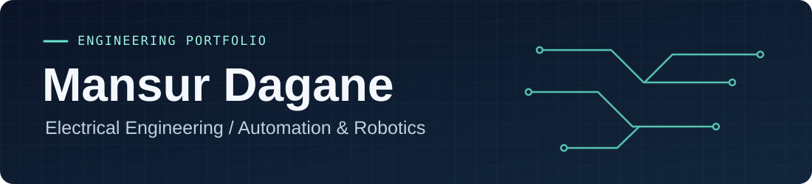

**First-year electrical engineering student at OsloMet** · Oslo, Norway  
Interested in embedded systems, automation, and how to test software that interacts with hardware. **Open to technical internships for summer 2027.**

## Selected projects

| Project | What to look at | Tools |
| :--- | :--- | :--- |
| [**Sensor Ops**](https://github.com/daganemansur-bit/sensor-ops) | Replays simulated voltage readings, flags missing data, and prevents duplicate records. | Python · FastAPI · SQLite |
| [**Firmware Verification Lab**](https://github.com/daganemansur-bit/firmware-verification) | Simulates a sensor alarm and tests threshold behavior, missing readings, and fault recovery. | C11 · Make · GCC · Clang |

Both projects include setup instructions and automated tests. The C simulator can export CSV data for the Python project to replay.

## What I'm learning now

I'm working through circuits and digital logic at OsloMet. My next step is to measure a voltage divider on a breadboard, compare the readings with calculations, and use those measurements to exercise the sensor pipeline.

[**Connect on LinkedIn ↗**](https://www.linkedin.com/in/mansur-m-dagane-396637346/)
